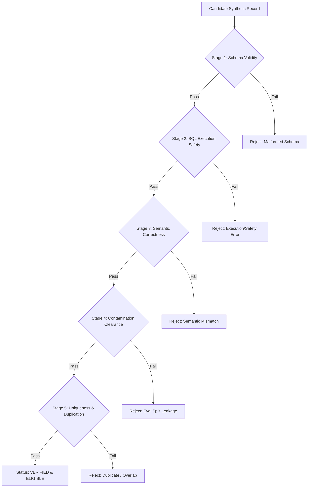

# SQLForge EXP-06: Synthetic vs. Human Data Protocol

This document formalizes the comparative protocol, synthetic record schema, semantic verification pipeline, and contamination auditing for **EXP-06-SYNTHETIC-DATA**.

---

## 1. Research Question & Hypotheses

### Primary Research Question
How does fine-tuning on execution-filtered, semantically verified synthetic text-to-SQL data compare in sample efficiency to human-annotated data, and does a 50/50 blend outperform pure human data under identical sample sizes?

### Hypotheses
- **Hypothesis $H_1$ (Synthetic Sample Parity):** Execution-filtered synthetic data achieves at least 90% of the execution accuracy of human data at an identical budget of $N = 3,000$ training examples.
- **Hypothesis $H_2$ (Blend Synergy):** A 50/50 blend (1,500 human + 1,500 synthetic) achieves equal or superior execution accuracy compared to 3,000 human examples by increasing syntactic pattern diversity while retaining human stylistic naturalness.
- **Hypothesis $H_3$ (Out-of-Domain Generalization):** Models trained on synthetic data exhibit different failure modes on cross-database benchmarks (`bird_mini:dev`) than models trained purely on human data.

---

## 2. Experimental Groups & Controlled Variables

### Fixed Comparison Groups ($N = 3,000$)

| Group | Human Examples | Synthetic Examples | Total Examples | Seeds | Total Conditions |
| :--- | :--- | :--- | :--- | :--- | :--- |
| `human_only` | 3,000 | 0 | 3,000 | 42, 43, 44 | 3 |
| `synthetic_only` | 0 | 3,000 | 3,000 | 42, 43, 44 | 3 |
| `human_synthetic_50_50` | 1,500 | 1,500 | 3,000 | 42, 43, 44 | 3 |

Total planned conditions: **9 runs**.

### Controlled Constants
All 9 conditions share:
- Identical base model: `Qwen/Qwen2.5-Coder-7B-Instruct`
- Identical verified LoRA rank and alpha from EXP-04
- Identical training method: 4-bit NF4 QLoRA
- Identical hyperparameters: 3 epochs, learning rate $2 \times 10^{-4}$ (cosine schedule), batch size 16 (per-device 8, accumulation 2)
- Identical prompt serialization: DDL schema representation, completion loss masking
- Identical evaluation benchmarks: `spider:dev` ($N = 1,034$) and `bird_mini:dev` ($N = 500$)

### Human Data Sampling
- Human examples are sampled strictly from `spider:train` using `NestedStratifiedSpiderSampler`.
- For each seed, the 1,500-example human subset is strictly nested within the 3,000-example human subset:
  $$D_{\text{human}, 1500}^{(s)} \subset D_{\text{human}, 3000}^{(s)}$$

---

## 3. Synthetic Data Sourcing & Anti-Fabrication Stance

### Current Corpus Availability
**No synthetic corpus currently exists in the repository.** In accordance with scientific integrity guidelines:
- Synthetic data is **not** generated, hallucinated, or mocked in Step 8.
- Step 8 establishes the complete ingestion, contract verification, and auditing infrastructure for externally supplied synthetic data.
- Live EXP-06 execution remains strictly blocked until a genuine, provenance-verified synthetic corpus is ingested.

---

## 4. Synthetic Record Schema & Ingestion Contract

Implemented in `SyntheticRecord` (`src/sqlforge/training/synthetic_validation.py`).

Each candidate synthetic record must satisfy a 14-attribute typed contract:
1. `synthetic_id`: Unique stable identifier (UUID or cryptographic hash).
2. `question`: Natural language user question.
3. `sql`: Target SQL query.
4. `database_id`: Target SQLite database identifier.
5. `schema_reference`: Associated database schema or DDL specification.
6. `source_model_id`: Generator model identifier (e.g., `meta-llama/Meta-Llama-3.1-70B-Instruct`).
7. `source_model_revision`: Git commit hash or revision of the generator model.
8. `generation_timestamp`: ISO 8601 generation timestamp.
9. `generation_config_hash`: SHA-256 hash of prompt templates, temperature, and sampling parameters.
10. `source_dataset_reference`: Source dataset used for few-shot prompting or seeding (e.g., `spider:train`).
11. `source_record_ids`: Specific training example IDs referenced during generation.
12. `verification_status`: Status flag (`unverified`, `verified`, `rejected`, `review_required`).
13. `verification_method`: Verification methodology (e.g., `dual_execution_and_semantic_ref`).
14. `verifier_version`: Semantic verifier software version.
15. `verification_artifact_hash`: Cryptographic hash of the verification log artifact.
16. `license_or_usage_rights`: Valid open-research or permissible commercial license identifier.

Records missing required provenance or referencing forbidden splits are rejected.

---

## 5. Five-Stage Validation & Verification Pipeline

Implemented in `SyntheticDataValidator` (`src/sqlforge/training/synthetic_validation.py`).

Execution success alone **does not** prove that a generated SQL query correctly answers a natural-language question (e.g., `SELECT * FROM table` executes without error but is semantically meaningless).

### Stage 1: Schema & Provenance Validity
- Validates all 14 required fields.
- Rejects empty questions, missing database identifiers, or invalid license strings.

### Stage 2: SQL Execution Safety
- Checks for SQL mutation vulnerabilities (`DROP`, `DELETE`, `INSERT`, `UPDATE`, `ALTER`, `ATTACH`).
- Executes candidate SQL within a read-only SQLite sandbox against the target database.
- Must execute cleanly without syntax errors, runtime exceptions, or timeouts.

### Stage 3: Semantic Correctness
- Requires independent semantic verification against an authorized reference query or a documented human-review decision.
- Rejects unverified candidate records from live training eligibility.

### Stage 4: Contamination Clearance
- Rejects any records referencing evaluation partitions (`spider:dev`, `spider:test`, `bird_mini:dev`, `held_out_custom:test`).
- Performs n-gram and fuzzy question overlap auditing against evaluation benchmarks.
- Fuzzy matches ($\ge 85\%$ lexical similarity) are flagged as `review_required` and excluded from training until audited.

### Stage 5: Uniqueness & Duplication
- Rejects exact duplicate normalized question/SQL pairs within the synthetic corpus.
- Rejects exact duplicates against the human training examples selected for the same condition.

---

## 6. Validation Reporting

`SyntheticDataValidator.validate_dataset` generates a comprehensive `SyntheticValidationReport`:
- `total_records`, `accepted_records`, `rejected_records`, `review_required_records`
- Detailed breakdown of rejection reasons:
  - Schema / provenance defects
  - Execution failures
  - Semantic verification failures
  - Benchmark contamination
  - Duplicate questions / queries
- Cryptographic hashes of accepted subsets.

---

## 7. Statistical Comparison & Reporting

Implemented in `DataScalingAnalyzer.analyze_exp06`:
- Seed-matched paired differences:
  $$\Delta_{\text{synth}} = \text{EX}(\text{synthetic\_only}_s) - \text{EX}(\text{human\_only}_s)$$
  $$\Delta_{\text{blend}} = \text{EX}(\text{human\_synthetic\_50\_50}_s) - \text{EX}(\text{human\_only}_s)$$
- Mean execution accuracy and standard deviation across seeds 42, 43, 44.
- Valid-SQL rate and exact match comparisons.
- No claim of equivalence, superiority, or non-inferiority is permitted without empirical GPU evaluation and statistical significance testing.

---

## 8. Current Implementation Status

- **Infrastructure:** **Complete** (Data structures, validators, isolation guards, CLI commands, and test suites verified).
- **Synthetic Data Ingestion:** **Blocked** (Awaiting external, provenance-verified synthetic corpus).
- **Empirical GPU Training:** **Pending** (Requires GPU instance, ~6 GPU-hours, and verified EXP-04 rank selection artifact).
